<!-- ==================================================================== -->
<!-- Animated GitHub Profile: Terminal Edition                            -->
<!-- Inspired by Avi Vashishta's terminal profile architecture            -->
<!-- Generated specifically for Justus Robin (@justusrobin2007)           -->
<!-- ==================================================================== -->

<h3><code>justus@github ~ $ ./contributions.sh</code></h3>

 
 

<!-- Side-by-side terminal cards:
     Left:  Self-typing monochrome ASCII portrait of Justus
     Right: Real-time streak & numbers stats card with monthly activity
     Both SVGs are 840x880 so 420px width matches both heights seamlessly.
-->

<h3><code>justus@github ~ $ whoami</code></h3>

<table>
  <tr>
    <td valign="top">
      
    </td>
    <td valign="top">
      
    </td>
  </tr>
</table>

 
 

<h3><code>justus@github ~ $ ./about.sh</code></h3>

  <b>Software Engineer · Food-Tech Architect · AI & RAG Builder</b> 
  <i>Passionate about engineering reliable full-stack applications, intelligent RAG systems, and developer tooling.</i>

  
  
  

 

<h3><code>justus@github ~ $ ./projects.sh --featured</code></h3>

<table>
  <tr>
    <td width="50%" valign="top">
      <h4><a href="https://github.com/justusrobin2007/RAJU-FOOD-COURT">🍽️ RAJU-FOOD-COURT</a></h4>
      
Modern food court management and digital ordering application built with TypeScript, featuring real-time menu management, streamlined ordering flow, and responsive design.

      
<code>TypeScript</code> · <code>Full-Stack</code> · <code>Web App</code>

    </td>
    <td width="50%" valign="top">
      <h4><a href="https://github.com/justusrobin2007/OFFLINE-RAG-CHAT-BOT">🤖 OFFLINE-RAG-CHAT-BOT</a></h4>
      
Local Retrieval-Augmented Generation (RAG) conversational bot designed for private, local document question-answering with zero data leakage.

      
<code>Python</code> · <code>RAG</code> · <code>LLM</code> · <code>Embeddings</code>

    </td>
  </tr>
  <tr>
    <td width="50%" valign="top">
      <h4><a href="https://github.com/justusrobin2007/ark-kitchen">👨‍🍳 ark-kitchen</a></h4>
      
Comprehensive kitchen operations and food service application streamlining culinary workflows, order management, and kitchen ticket dispatching.

      
<code>Full-Stack</code> · <code>Food-Tech</code> · <code>Automation</code>

    </td>
    <td width="50%" valign="top">
      <h4><a href="https://github.com/justusrobin2007/Recipe-">📖 Recipe-</a></h4>
      
Interactive cooking companion with structured culinary guides, ingredient calculators, and step-by-step recipes (including signature dishes like authentic chicken rice).

      
<code>HTML5</code> · <code>CSS3</code> · <code>UI/UX</code>

    </td>
  </tr>
</table>

 

<h3><code>justus@github ~ $ ./stack.sh</code></h3>

  
  
  
  
  
  
  
  

 

---

Terminal session active · Generated with self-contained SMIL SVGs & automated GitHub Actions · Keep building 🚀

